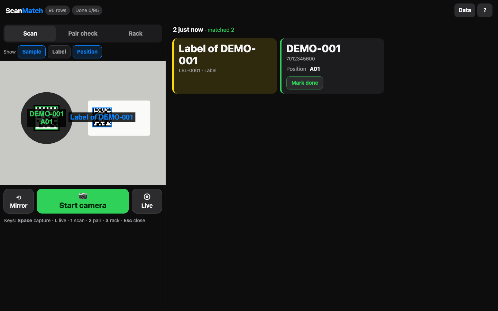
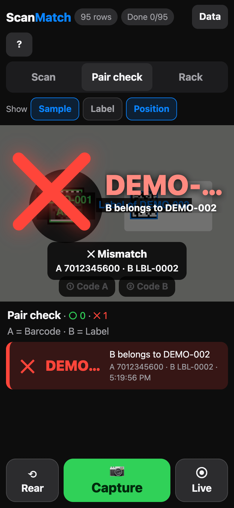
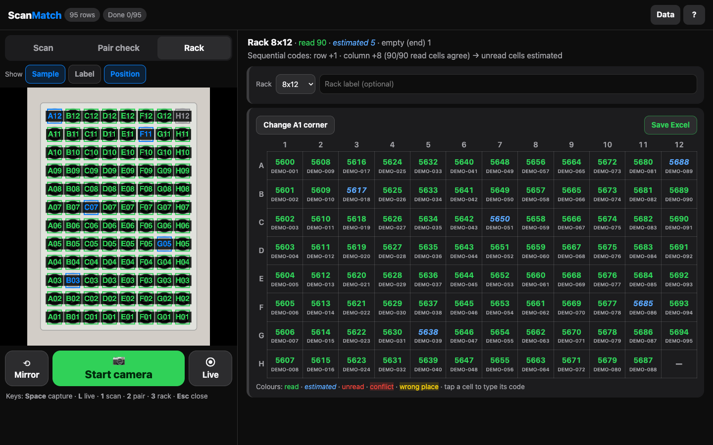

# ScanMatch

**Point your camera at barcodes. See what your spreadsheet says. One HTML file, no server, no install.**

[](LICENSE)
[](https://wmyung.github.io/scanmatch/)
[](#privacy)
[](#)

ScanMatch turns any phone, tablet or laptop into a **barcode → spreadsheet lookup station**:

- **Upload an Excel/CSV, link a Google Sheet, or type a table** whose first column is a barcode (QR, DataMatrix, Code128, EAN, …).
- **Scan** — one photo can read dozens of codes; matching rows appear *on the image* and as cards. Mark items done to track progress.
- **Pair check** — show code A (a tube) then code B (the label you just stuck on it). Right label → big **○**, wrong label → big **✕** with where that label belongs.
- **Rack** — photograph a whole 96‑well rack or 9×9 box from above. Every tube lands in its row/column, unread cells are **estimated from the numbering pattern** (and coloured differently), and you get an **Excel file**. Add a position column and it becomes an **order check**.

Built from a real lab workflow (labelling ~1,000 biobank tubes for shipment), then stripped of every lab-specific piece so anyone can use it.

**Try it:** <https://wmyung.github.io/scanmatch/> → *Data* → *Load sample*, then capture one of the [sample photos](samples/photos).

| Scan | Pair check | Rack → Excel |
|---|---|---|
|  |  |  |

---

## Why ScanMatch?

Most barcode apps answer *"what does this code say?"*. Bench work needs *"which row of my sheet is this, is it the right one, and where does it go?"* — for many codes at once, with gloves on, without sending anything to a cloud.

| | **ScanMatch** | Phone barcode apps | Spreadsheet + USB scanner | Rack scanner hardware |
|---|---|---|---|---|
| **Many codes per photo** | ✅ dozens | ❌ one | ❌ one | ✅ |
| **Shows your own columns on the image** | ✅ | ❌ | ❌ | ❌ |
| **Pair check (tube ↔ label) with ○/✕** | ✅ | ❌ | manual | ❌ |
| **Whole rack → position table → Excel** | ✅ | ❌ | ❌ | ✅ |
| **Estimates unread cells (sequential codes)** | ✅ | ❌ | ❌ | rarely |
| **Laser-etched / low-contrast codes** | ✅ tilt-aligned + gap-filling | ❌ | ❌ | ✅ |
| **Cost** | free | free | a USB scanner | dedicated hardware |
| **Data leaves your device** | **never** | depends on the app | no | no |
| **Install** | none (open a URL) | app store | driver | vendor software |

---

## Quick start

```bash
# Use it: open the hosted page (HTTPS is required for the live camera)
open https://wmyung.github.io/scanmatch/

# Or self-host the single file anywhere that serves HTTPS
curl -LO https://raw.githubusercontent.com/wmyung/scanmatch/main/index.html
```

1. **Data** → upload `.xlsx` / `.csv`, paste a Google Sheet link (*anyone with the link can view*), or edit the built-in sheet (paste straight from Excel).
2. Pick the **barcode column**, optionally a **compare column** (pair check) and a **position column** (rack order check).
3. **Capture** (any camera) or **Live**. On a laptop the capture button turns the webcam on, then captures.

Keyboard: `Space` capture · `L` live · `1` scan · `2` pair · `3` rack · `Esc` close.

---

## What's inside

| Piece | How |
|---|---|
| Decoding | [zxing-cpp](https://github.com/zxing-cpp/zxing-cpp) via [zxing-wasm](https://github.com/Sec-ant/zxing-wasm), inlined — no network calls |
| Speed | up to 3 **Web Workers** decode tiles in parallel (≈2.6× faster on multi-core devices, UI never freezes) |
| Hard photos | multi-resolution + tiled search, blur/moiré correction (gaussian + laplacian sharpening), per-cell re-read |
| Laser-etched codes | estimate tilt from Sobel gradients → rotate to axis → adaptive threshold + **binary closing** to fill dot gaps (92% of distorted test frames decoded, ≈3 attempts) |
| Rack geometry | lattice fitted from decoded code centres (neighbour-vector directions + homography); no rack template needed |
| Unread cells | integer fit `code = a + Δrow·r + Δcol·c`; cells that disagree are flagged, cells that weren't read are estimated |
| A1 corner | smallest code (sequential racks) or the diagonal of the single empty corner; one-tap override |
| Labels on photos | collision-aware layout: shrink, then push apart, keep inside the visible area; optional *hold* after a code leaves view |
| Excel | tiny built-in `.xlsx` reader (zip + `DecompressionStream`) and writer (styles: estimated = blue italic, problems = red) |
| Layout | phone: camera on top; tablet/laptop: fixed-size camera left, data right |

Everything is one ~1.4 MB `index.html`. Source lives in `src/` and is concatenated by `tools/build.py`.

---

## Privacy

- No server, no account, no analytics, no external requests (except a Google Sheet you choose to import).
- Your table, done-marks and scan log live in the browser's local storage until you delete them (*Data → Delete table*).
- The sample data and photos in this repo are **fictional** and generated by `tools/make_samples.py`.

---

## Develop

```bash
python3 tools/build.py             # src/* → index.html
python3 tools/make_samples.py      # regenerate fictional sample data & photos (pip install ppf.datamatrix pillow)
python3 tools/test.py              # end-to-end check in headless Chrome (pip install playwright)
```

## License

MIT. Embedded third-party code: see [THIRD_PARTY_NOTICES.md](THIRD_PARTY_NOTICES.md) (zxing-wasm MIT, zxing-cpp Apache-2.0).

한국어 설명: [README.ko.md](README.ko.md) · 소개 글: [PROMO.md](PROMO.md)
